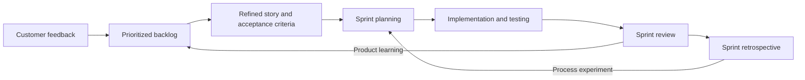

# SNHU Travel Agile Delivery Case Study

> A privacy-reviewed portfolio case study showing how customer feedback becomes prioritized, testable, and reviewable work in Scrum.

## Recruiter Quick View

| Capability | Evidence |
|---|---|
| Product thinking | Customer feedback is translated into a product goal, backlog decisions, and user value |
| Requirements analysis | Stories define the user, desired behavior, acceptance criteria, boundaries, and open questions |
| Quality engineering | Gherkin scenarios and a concrete test case connect requirements to verifiable outcomes |
| Agile delivery | Work moves through refinement, planning, implementation, testing, review, and retrospective |
| Cross-functional collaboration | Product Owner, Developer, Tester, and Scrum Master responsibilities are applied honestly to one scenario |
| Continuous improvement | Retrospective actions include an owner, next-sprint behavior, and evidence of completion |
| Professional integrity | Academic practice is distinguished from commercial experience and production results |

## The Scenario

SNHU Travel is a course-based travel-product scenario shaped by changing customer preferences. The proposed experience includes destinations, vacation styles, cruises, price limits, promotions, and personalized recommendations.

This domain is a strong fit for iterative delivery: preferences, prices, availability, and promotions can change, so the team needs fast feedback without sacrificing clear scope or quality.

## What I Practiced

I worked through the scenario from several Scrum perspectives rather than claiming one permanent production role.

| Perspective | Responsibility demonstrated |
|---|---|
| Product Owner | Interpreted feedback, clarified user value, and prioritized backlog decisions |
| Developer | Evaluated feasibility, dependencies, validation, and the effect of requirement changes |
| Tester | Turned acceptance criteria into observable test conditions and exposed ambiguity early |
| Scrum Master | Made blockers visible and converted retrospective insights into small process experiments |

## Portfolio Artifacts

- [Agile Delivery Case Study](docs/agile-delivery-case-study.md) — the full analysis of delivery decisions, role collaboration, change handling, and quality strategy.
- [Agile Artifact Examples](docs/agile-artifact-examples.md) — a refined story, Gherkin acceptance criteria, test case, Definitions of Ready and Done, and a retrospective action plan.
- [Competency Evidence Map](docs/competency-evidence-map.md) — a reviewer-friendly trace from each claimed competency to concrete evidence and its limits.

## Delivery Model

The Sprint Review improves the product backlog; the Sprint Retrospective improves the delivery system.

## Key Recommendation

The highest-value improvement is to review uncertain acceptance criteria with the Product Owner, Developer, and Tester before implementation. Questions about multiple vacation types, price boundaries, currency, and empty-result behavior should become explicit decisions while the team still has options.

## Public-Safety Controls

This repository contains only professionally rewritten portfolio material. The original course submission remains in a private academic archive. A lightweight automated check blocks private-source document formats, known sensitive phrases, local machine paths, and broken relative Markdown links.

## Scope and Integrity

This is an academic process case study, not a deployed travel application or commercial client engagement. It demonstrates analysis and Scrum practices; it does not claim production metrics, customer outcomes, or employment by SNHU Travel.

No open-source license is granted. See [NOTICE.md](NOTICE.md) for portfolio-use terms.

