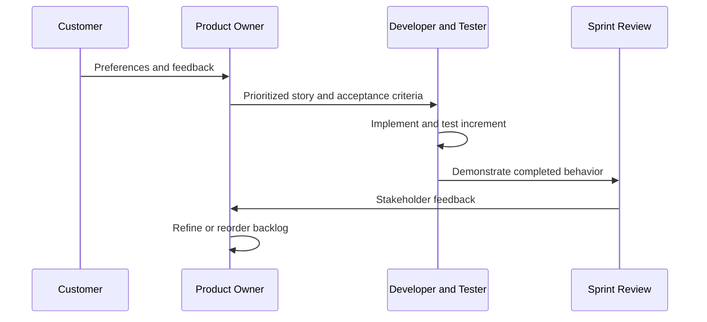

# SNHU Travel Agile Delivery Case Study

## Executive Summary

The SNHU Travel scenario demonstrates how Scrum connects changing customer needs to small, testable increments. I practiced Product Owner, Developer, Tester, and Scrum Master responsibilities in an academic setting. The central lesson was that delivery becomes more predictable when product, development, and testing clarify acceptance criteria together before implementation.

This case study presents a professional interpretation of that work. It does not describe a commercial deployment.

## Product Context

The proposed travel experience must respond to customer interests across destinations, vacation styles, cruises, pricing, promotions, and personalized recommendations. Those needs are not static: availability, prices, and traveler priorities can shift quickly.

The product backlog therefore needs two qualities at once:

1. **Adaptability** — new evidence can change future priorities.
2. **Clarity** — active work has a clear goal and observable completion conditions.

## From Feedback to Testable Work

A customer request becomes delivery-ready only after the team understands:

1. Who needs the capability.
2. What the person is trying to accomplish.
3. Why the outcome matters.
4. Which observable behaviors demonstrate success.
5. Which boundaries, error states, dependencies, and assumptions remain unresolved.

A story communicates intent; acceptance criteria make that intent testable. A price-filter story, for example, is incomplete until the team decides whether boundaries are inclusive, what happens when the minimum exceeds the maximum, and how an empty result is explained.

The [Agile Artifact Examples](agile-artifact-examples.md) apply this reasoning to a concrete user story and test case.

## Applying Scrum Responsibilities

### Product Owner perspective

The Product Owner keeps the backlog aligned with customer value. In this scenario, that means interpreting feedback, prioritizing travel capabilities, clarifying acceptance criteria, and deciding how new information affects backlog order.

### Developer perspective

The Developer evaluates how a story can become a complete increment. When requirements change, the Developer identifies affected behavior, data, dependencies, validation, and test coverage instead of silently expanding scope.

### Tester perspective

The Tester converts acceptance criteria into observable conditions. Questions such as whether travelers can select multiple vacation types or whether price boundaries are inclusive should be raised before implementation, not discovered after the feature is built.

### Scrum Master perspective

The Scrum Master improves the system of work by making blockers visible, supporting useful Scrum events, and helping the team run a focused process experiment. The role facilitates delivery; it does not assign work as a traditional project manager.

## Iterative Delivery

Scrum allows the experience to progress in reviewable slices instead of waiting until the entire product is designed, built, and tested.

A story is complete when the behavior satisfies its acceptance criteria, relevant tests pass, and the increment can be demonstrated. Work that is merely coded is not automatically done.

## Responding to Change

Agile does not mean accepting unlimited change without structure. When a new request appears, I would:

1. Confirm the underlying customer need.
2. Decide whether the request clarifies active work or creates new scope.
3. Evaluate its effect on the sprint goal, dependencies, and testing.
4. Let the Product Owner make the priority decision.
5. Update the backlog and acceptance criteria.
6. Communicate the decision and its impact to the team.

This protects the sprint goal while allowing the product to adapt. A newly important cruise preference or promotion filter can be prioritized without hiding the effect on other work.

## Communication as Risk Reduction

Useful communication is specific, timely, and directed to the person who can decide or act.

> Tester to Product Owner: Can travelers select more than one vacation type, and how should combined selections affect the results?

> Developer to Product Owner: Should the price filter accept both minimum and maximum values, and what validation appears when the range is reversed?

These questions expose assumptions before they become defects. Raising a blocker early preserves options; waiting until the Sprint Review removes them.

## Sprint Review

The Sprint Review inspects the product increment, not individual activity. The team demonstrates completed travel behavior against acceptance criteria, captures stakeholder feedback, and updates the backlog or release outlook. Incomplete work remains visible and is not presented as finished.

## Sprint Retrospective

The retrospective inspects the delivery process. The scenario supports three practical directions:

- **Keep:** clear acceptance criteria, early testing, and open communication.
- **Start:** review uncertain requirements earlier across Product Owner, Developer, and Tester perspectives.
- **Stop:** waiting too long to raise blockers that affect development, testing, or backlog decisions.

The improvement is an experiment, not a slogan. In the next sprint, the team should check whether refinement questions were resolved before work began and whether fewer stories entered development with unclear acceptance criteria.

## Agile Evaluation

Scrum fits SNHU Travel because the product depends on feedback and changing preferences. Its advantage is not speed alone; it is the ability to learn and adjust while still delivering testable increments.

The method also depends on transparency. If team members do not update work, participate in events, or raise questions, Scrum loses its feedback advantage. The events create opportunities for evidence-based decisions, but the team must use them well.

## Production-Ready Extensions

In a live project, I would add:

- A prioritized backlog connected to explicit product outcomes
- Sprint goals that produce coherent increments
- Shared Definitions of Ready and Done
- Story-level acceptance criteria linked to test evidence
- Dependency, risk, and blocker tracking
- Review feedback captured as backlog decisions
- Retrospective actions with owners and review dates
- A small set of team-level delivery and quality indicators

Cycle time, blocked time, escaped defects, and sprint-goal outcomes can help a team understand its delivery system. They should not be used to rank individuals, and this case study does not claim measured production results.

## Evidence Boundary

The original course submission is retained privately. This repository publishes only a reviewed, professional interpretation of the learning. It contains no raw course prompt, instructor information, private contact details, or claims of commercial deployment.

Return to the [repository overview](../README.md) or review the [competency evidence map](competency-evidence-map.md).

