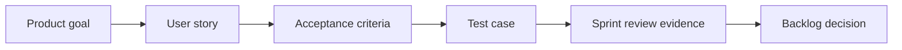

# Competency Evidence Map

This map connects each portfolio claim to observable evidence while keeping academic practice distinct from production experience.

| Competency | Concrete evidence | What it demonstrates | Evidence boundary |
|---|---|---|---|
| Product thinking | Product goal and customer-value statement | Connects features to a customer outcome | Scenario-based analysis, not market validation |
| Requirements analysis | Refined price-filter story and open questions | Identifies users, value, rules, boundaries, and ambiguity | Illustrative artifact, not a production backlog record |
| Acceptance criteria | Three Gherkin scenarios | Converts intent into observable success, validation, and empty-state behavior | Proposed behavior, not implemented software |
| Test design | Test case with preconditions, data, expected result, and boundary follow-up | Traces a requirement to verifiable evidence | Test design only; no execution results are claimed |
| Change management | Cabin-preference decision table | Separates clarification from new scope and preserves Product Owner accountability | Recommended decision process |
| Scrum role literacy | Responsibility analysis across four perspectives | Distinguishes product, delivery, quality, and facilitation concerns | Roles practiced in coursework, not job titles claimed |
| Continuous improvement | Keep/start/stop action plan with owner and evidence | Turns reflection into a reviewable next-sprint experiment | Proposed experiment, not measured production improvement |
| Professional integrity | Scope statements and private-source boundary | Prevents academic work from being represented as commercial experience | Public portfolio contains rewritten materials only |

## Traceability Path

The strongest evidence chain is not the number of documents produced. It is the ability to trace customer value through a story, observable behavior, verification, and a decision.

Return to the [repository overview](../README.md).

